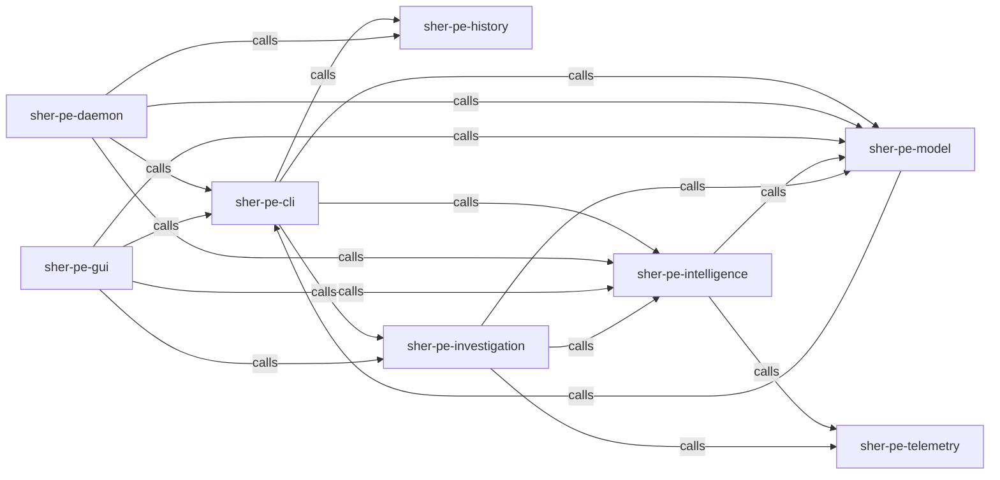

_Generated by CodeAtlas._

## Details

Owns 0 symbols across 0 file(s).

### sher-pe-cli

Owns 0 symbols across 1 file(s).

**Related Classes/Methods:** _None_

### sher-pe-daemon

Owns 0 symbols across 1 file(s).

**Related Classes/Methods:** _None_

### sher-pe-gui

Owns 0 symbols across 1 file(s).

**Related Classes/Methods:** _None_

### sher-pe-history

Owns 0 symbols across 1 file(s).

**Related Classes/Methods:** _None_

### sher-pe-intelligence

Owns 0 symbols across 1 file(s).

**Related Classes/Methods:** _None_

### sher-pe-investigation

Owns 0 symbols across 1 file(s).

**Related Classes/Methods:** _None_

### sher-pe-model

Owns 0 symbols across 1 file(s).

**Related Classes/Methods:** _None_

### sher-pe-telemetry

Owns 0 symbols across 1 file(s).

**Related Classes/Methods:** _None_
