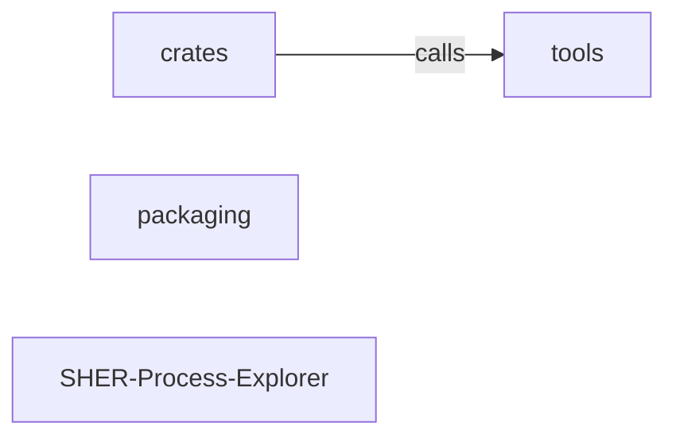

_Generated by CodeAtlas._

## Details

Architecture map of SHER-Process-Explorer.

### crates

Owns 0 symbols across 0 file(s).

**Related Classes/Methods:** _None_

### packaging

Owns 0 symbols across 0 file(s).

**Related Classes/Methods:** _None_

### tools

Owns 0 symbols across 0 file(s).

**Related Classes/Methods:** _None_

### SHER-Process-Explorer

Owns 0 symbols across 13 file(s).

**Related Classes/Methods:** _None_
