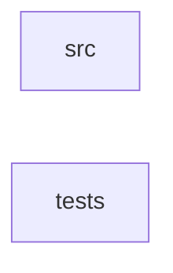

_Generated by CodeAtlas._

## Details

Owns 0 symbols across 1 file(s).

### src

Owns 35 symbols across 2 file(s).

**Related Classes/Methods:** _None_

**Source Files:**

- `crates/sher-pe-cli/src/main.rs`
  - `crates.sher-pe-cli.src.main.Cli`
  - `crates.sher-pe-cli.src.main.Command`
  - `crates.sher-pe-cli.src.main.Signal.from`
  - `crates.sher-pe-cli.src.main.SignalArg`
  - `crates.sher-pe-cli.src.main.WhyAspect`
  - `crates.sher-pe-cli.src.main.default_history_db_path`
  - `crates.sher-pe-cli.src.main.main`
  - `crates.sher-pe-cli.src.main.reset_sigpipe`
- `crates/sher-pe-cli/src/render.rs`
  - `crates.sher-pe-cli.src.render.deep_trace`
  - `crates.sher-pe-cli.src.render.export`
  - `crates.sher-pe-cli.src.render.history`
  - `crates.sher-pe-cli.src.render.history.History`
  - `crates.sher-pe-cli.src.render.inspect`
  - `crates.sher-pe-cli.src.render.inspect.Inspection`
  - `crates.sher-pe-cli.src.render.investigate`
  - `crates.sher-pe-cli.src.render.kill`
  - `crates.sher-pe-cli.src.render.kill.KillResult`
  - `crates.sher-pe-cli.src.render.not_found_error`
  - `crates.sher-pe-cli.src.render.now_unix`
  - `crates.sher-pe-cli.src.render.print_finding`
  - `crates.sher-pe-cli.src.render.print_json_or`
  - `crates.sher-pe-cli.src.render.print_subtree`
  - `crates.sher-pe-cli.src.render.profile`
  - `crates.sher-pe-cli.src.render.ps`
  - `crates.sher-pe-cli.src.render.system`
  - `crates.sher-pe-cli.src.render.tests.history_rejects_negative_since_secs_before_opening_the_database`
  - `crates.sher-pe-cli.src.render.tests.history_zero_since_secs_is_accepted_and_reaches_the_database`
  - `crates.sher-pe-cli.src.render.timeline`
  - `crates.sher-pe-cli.src.render.timeline.Item`
  - `crates.sher-pe-cli.src.render.timeline.Timeline`
  - `crates.sher-pe-cli.src.render.trace`
  - `crates.sher-pe-cli.src.render.tree`
  - `crates.sher-pe-cli.src.render.who_has`
  - `crates.sher-pe-cli.src.render.who_has.Match`
  - `crates.sher-pe-cli.src.render.why`

### tests

Owns 1 symbols across 1 file(s).

**Related Classes/Methods:** _None_

**Source Files:**

- `crates/sher-pe-cli/tests/packaging_metadata.rs`
  - `crates.sher-pe-cli.tests.packaging_metadata.deb_copyright_holder_matches_license_copyright_holder`
