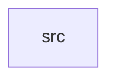

_Generated by CodeAtlas._

## Details

Owns 0 symbols across 1 file(s).

### src

Owns 8 symbols across 1 file(s).

**Related Classes/Methods:** _None_

**Source Files:**

- `crates/sher-pe-daemon/src/main.rs`
  - `crates.sher-pe-daemon.src.main.Cli`
  - `crates.sher-pe-daemon.src.main.default_db_path`
  - `crates.sher-pe-daemon.src.main.handle_shutdown_signal`
  - `crates.sher-pe-daemon.src.main.install_signal_handlers`
  - `crates.sher-pe-daemon.src.main.main`
  - `crates.sher-pe-daemon.src.main.now_unix`
  - `crates.sher-pe-daemon.src.main.persist_tick`
  - `crates.sher-pe-daemon.src.main.sleep_interruptible`
