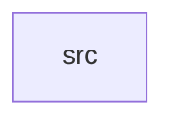

_Generated by CodeAtlas._

## Details

Owns 0 symbols across 1 file(s).

### src

Owns 96 symbols across 25 file(s).

**Related Classes/Methods:** _None_

**Source Files:**

- `crates/sher-pe-model/src/cgroup.rs`
  - `crates.sher-pe-model.src.cgroup.CgroupInfo`
  - `crates.sher-pe-model.src.cgroup.CgroupVersion`
  - `crates.sher-pe-model.src.cgroup.tests.cgroup_info_json_round_trip`
- `crates/sher-pe-model/src/container.rs`
  - `crates.sher-pe-model.src.container.ContainerInfo`
  - `crates.sher-pe-model.src.container.ContainerRuntime`
  - `crates.sher-pe-model.src.container.tests.container_info_json_round_trip`
- `crates/sher-pe-model/src/cpu.rs`
  - `crates.sher-pe-model.src.cpu.CpuStats`
  - `crates.sher-pe-model.src.cpu.CpuStats.total_ticks`
  - `crates.sher-pe-model.src.cpu.tests.cpu_stats_json_round_trip`
  - `crates.sher-pe-model.src.cpu.tests.total_ticks_sums_user_and_system`
- `crates/sher-pe-model/src/diagnostic.rs`
  - `crates.sher-pe-model.src.diagnostic.DiagnosticReport`
  - `crates.sher-pe-model.src.diagnostic.tests.diagnostic_report_json_round_trip`
- `crates/sher-pe-model/src/environment.rs`
  - `crates.sher-pe-model.src.environment.EnvVar`
  - `crates.sher-pe-model.src.environment.tests.env_var_json_round_trip`
- `crates/sher-pe-model/src/evidence.rs`
  - `crates.sher-pe-model.src.evidence.Confidence`
  - `crates.sher-pe-model.src.evidence.Evidence`
  - `crates.sher-pe-model.src.evidence.Finding`
  - `crates.sher-pe-model.src.evidence.Finding.new`
  - `crates.sher-pe-model.src.evidence.Severity`
  - `crates.sher-pe-model.src.evidence.tests.confidence_orders_from_weakest_to_strongest`
  - `crates.sher-pe-model.src.evidence.tests.finding_json_round_trip`
  - `crates.sher-pe-model.src.evidence.tests.finding_new_allows_unknown_without_evidence`
  - `crates.sher-pe-model.src.evidence.tests.finding_new_panics_on_unsupported_confidence`
- `crates/sher-pe-model/src/fd_limits.rs`
  - `crates.sher-pe-model.src.fd_limits.FdLimits`
  - `crates.sher-pe-model.src.fd_limits.tests.fd_limits_json_round_trip`
- `crates/sher-pe-model/src/files.rs`
  - `crates.sher-pe-model.src.files.FileKind`
  - `crates.sher-pe-model.src.files.OpenFile`
  - `crates.sher-pe-model.src.files.tests.open_file_json_round_trip`
- `crates/sher-pe-model/src/io.rs`
  - `crates.sher-pe-model.src.io.DiskIoStats`
  - `crates.sher-pe-model.src.io.tests.disk_io_stats_json_round_trip`
- `crates/sher-pe-model/src/log_entry.rs`
  - `crates.sher-pe-model.src.log_entry.LogEntry`
  - `crates.sher-pe-model.src.log_entry.tests.log_entry_json_round_trip`
- `crates/sher-pe-model/src/mapped_file.rs`
  - `crates.sher-pe-model.src.mapped_file.MappedFile`
  - `crates.sher-pe-model.src.mapped_file.tests.mapped_file_json_round_trip`
- `crates/sher-pe-model/src/memory.rs`
  - `crates.sher-pe-model.src.memory.MemoryBreakdown`
  - `crates.sher-pe-model.src.memory.MemoryBreakdown.is_detailed`
  - `crates.sher-pe-model.src.memory.tests.is_detailed_false_for_statm_fallback`
  - `crates.sher-pe-model.src.memory.tests.is_detailed_true_when_smaps_rollup_present`
  - `crates.sher-pe-model.src.memory.tests.memory_breakdown_json_round_trip`
- `crates/sher-pe-model/src/namespace.rs`
  - `crates.sher-pe-model.src.namespace.NamespaceInfo`
  - `crates.sher-pe-model.src.namespace.tests.namespace_info_json_round_trip`
- `crates/sher-pe-model/src/network.rs`
  - `crates.sher-pe-model.src.network.ConnectionState`
  - `crates.sher-pe-model.src.network.ConnectionState.from_proc_hex`
  - `crates.sher-pe-model.src.network.NetworkConnection`
  - `crates.sher-pe-model.src.network.Protocol`
  - `crates.sher-pe-model.src.network.tests.connection_state_from_proc_hex_covers_common_values`
  - `crates.sher-pe-model.src.network.tests.network_connection_json_round_trip`
- `crates/sher-pe-model/src/process.rs`
  - `crates.sher-pe-model.src.process.ProcessSnapshot`
  - `crates.sher-pe-model.src.process.ProcessState`
  - `crates.sher-pe-model.src.process.ProcessState.from_proc_char`
  - `crates.sher-pe-model.src.process.tests.process_snapshot_json_round_trip`
  - `crates.sher-pe-model.src.process.tests.state_from_proc_char_covers_common_codes`
- `crates/sher-pe-model/src/process_control.rs`
  - `crates.sher-pe-model.src.process_control.Signal`
  - `crates.sher-pe-model.src.process_control.Signal.all`
  - `crates.sher-pe-model.src.process_control.Signal.fmt`
  - `crates.sher-pe-model.src.process_control.Signal.is_uncatchable`
  - `crates.sher-pe-model.src.process_control.Signal.name`
  - `crates.sher-pe-model.src.process_control.tests.all_contains_every_signal_exactly_once_in_a_stable_order`
  - `crates.sher-pe-model.src.process_control.tests.kill_and_stop_are_uncatchable_others_are_not`
  - `crates.sher-pe-model.src.process_control.tests.name_matches_posix_signal_names`
- `crates/sher-pe-model/src/profiling.rs`
  - `crates.sher-pe-model.src.profiling.HotFunction`
  - `crates.sher-pe-model.src.profiling.SyscallStat`
  - `crates.sher-pe-model.src.profiling.tests.hot_function_json_round_trip`
  - `crates.sher-pe-model.src.profiling.tests.syscall_stat_json_round_trip`
- `crates/sher-pe-model/src/scheduler.rs`
  - `crates.sher-pe-model.src.scheduler.SchedulerStats`
  - `crates.sher-pe-model.src.scheduler.SchedulerStats.wait_ratio_percent`
  - `crates.sher-pe-model.src.scheduler.tests.scheduler_stats_json_round_trip`
  - `crates.sher-pe-model.src.scheduler.tests.wait_ratio_percent_computes_fraction_waiting`
  - `crates.sher-pe-model.src.scheduler.tests.wait_ratio_percent_none_when_no_time_accounted`
- `crates/sher-pe-model/src/security.rs`
  - `crates.sher-pe-model.src.security.SecurityContext`
  - `crates.sher-pe-model.src.security.tests.security_context_json_round_trip`
- `crates/sher-pe-model/src/system.rs`
  - `crates.sher-pe-model.src.system.LoadAverage`
  - `crates.sher-pe-model.src.system.SystemMemory`
  - `crates.sher-pe-model.src.system.SystemMemory.swap_used`
  - `crates.sher-pe-model.src.system.SystemMemory.used`
  - `crates.sher-pe-model.src.system.SystemOverview`
  - `crates.sher-pe-model.src.system.tests.system_memory_used_and_swap_used`
  - `crates.sher-pe-model.src.system.tests.system_overview_json_round_trip`
- `crates/sher-pe-model/src/thread.rs`
  - `crates.sher-pe-model.src.thread.ThreadSnapshot`
  - `crates.sher-pe-model.src.thread.tests.thread_snapshot_json_round_trip`
- `crates/sher-pe-model/src/timeline.rs`
  - `crates.sher-pe-model.src.timeline.TimelineEvent`
  - `crates.sher-pe-model.src.timeline.TimelineEventKind`
  - `crates.sher-pe-model.src.timeline.tests.timeline_event_json_round_trip`
- `crates/sher-pe-model/src/trace_event.rs`
  - `crates.sher-pe-model.src.trace_event.TraceEvent`
  - `crates.sher-pe-model.src.trace_event.tests.trace_event_json_round_trip`
- `crates/sher-pe-model/src/tree.rs`
  - `crates.sher-pe-model.src.tree.FamilyRollup`
  - `crates.sher-pe-model.src.tree.ProcessTree`
  - `crates.sher-pe-model.src.tree.ProcessTree.aggregate`
  - `crates.sher-pe-model.src.tree.ProcessTree.build`
  - `crates.sher-pe-model.src.tree.ProcessTree.family`
  - `crates.sher-pe-model.src.tree.ProcessTree.roots`
  - `crates.sher-pe-model.src.tree.tests.aggregate_returns_none_for_absent_pid`
  - `crates.sher-pe-model.src.tree.tests.aggregate_sums_family_resources`
  - `crates.sher-pe-model.src.tree.tests.build_links_children_and_skips_absent_parents`
  - `crates.sher-pe-model.src.tree.tests.family_includes_self_and_all_descendants`
  - `crates.sher-pe-model.src.tree.tests.snap`
