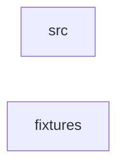

_Generated by CodeAtlas._

## Details

Owns 0 symbols across 1 file(s).

### src

Owns 38 symbols across 2 file(s).

**Related Classes/Methods:** _None_

**Source Files:**

- `crates/sher-pe-telemetry/src/lib.rs`
  - `crates.sher-pe-telemetry.src.lib.TelemetryAdapter`
  - `crates.sher-pe-telemetry.src.lib.TelemetryError`
  - `crates.sher-pe-telemetry.src.lib.Tier`
- `crates/sher-pe-telemetry/src/testing.rs`
  - `crates.sher-pe-telemetry.src.testing.MockTelemetryAdapter`
  - `crates.sher-pe-telemetry.src.testing.MockTelemetryAdapter.cgroup`
  - `crates.sher-pe-telemetry.src.testing.MockTelemetryAdapter.connections`
  - `crates.sher-pe-telemetry.src.testing.MockTelemetryAdapter.container_info`
  - `crates.sher-pe-telemetry.src.testing.MockTelemetryAdapter.disk_io`
  - `crates.sher-pe-telemetry.src.testing.MockTelemetryAdapter.environment`
  - `crates.sher-pe-telemetry.src.testing.MockTelemetryAdapter.fd_limits`
  - `crates.sher-pe-telemetry.src.testing.MockTelemetryAdapter.journal_entries`
  - `crates.sher-pe-telemetry.src.testing.MockTelemetryAdapter.kernel_log_for`
  - `crates.sher-pe-telemetry.src.testing.MockTelemetryAdapter.list_pids`
  - `crates.sher-pe-telemetry.src.testing.MockTelemetryAdapter.mapped_files`
  - `crates.sher-pe-telemetry.src.testing.MockTelemetryAdapter.namespaces`
  - `crates.sher-pe-telemetry.src.testing.MockTelemetryAdapter.new`
  - `crates.sher-pe-telemetry.src.testing.MockTelemetryAdapter.open_files`
  - `crates.sher-pe-telemetry.src.testing.MockTelemetryAdapter.process`
  - `crates.sher-pe-telemetry.src.testing.MockTelemetryAdapter.remove_process`
  - `crates.sher-pe-telemetry.src.testing.MockTelemetryAdapter.scheduler_stats`
  - `crates.sher-pe-telemetry.src.testing.MockTelemetryAdapter.security`
  - `crates.sher-pe-telemetry.src.testing.MockTelemetryAdapter.send_signal`
  - `crates.sher-pe-telemetry.src.testing.MockTelemetryAdapter.sent_signals`
  - `crates.sher-pe-telemetry.src.testing.MockTelemetryAdapter.set_connections`
  - `crates.sher-pe-telemetry.src.testing.MockTelemetryAdapter.set_container_info`
  - `crates.sher-pe-telemetry.src.testing.MockTelemetryAdapter.set_disk_io`
  - `crates.sher-pe-telemetry.src.testing.MockTelemetryAdapter.set_environment`
  - `crates.sher-pe-telemetry.src.testing.MockTelemetryAdapter.set_fd_limits`
  - `crates.sher-pe-telemetry.src.testing.MockTelemetryAdapter.set_journal_entries`
  - `crates.sher-pe-telemetry.src.testing.MockTelemetryAdapter.set_kernel_log`
  - `crates.sher-pe-telemetry.src.testing.MockTelemetryAdapter.set_open_files`
  - `crates.sher-pe-telemetry.src.testing.MockTelemetryAdapter.set_process`
  - `crates.sher-pe-telemetry.src.testing.MockTelemetryAdapter.set_scheduler_stats`
  - `crates.sher-pe-telemetry.src.testing.MockTelemetryAdapter.set_system_overview`
  - `crates.sher-pe-telemetry.src.testing.MockTelemetryAdapter.set_threads`
  - `crates.sher-pe-telemetry.src.testing.MockTelemetryAdapter.system_overview`
  - `crates.sher-pe-telemetry.src.testing.MockTelemetryAdapter.systemd_unit`
  - `crates.sher-pe-telemetry.src.testing.MockTelemetryAdapter.threads`

### fixtures

Owns 0 symbols across 0 file(s).

**Related Classes/Methods:** _None_
